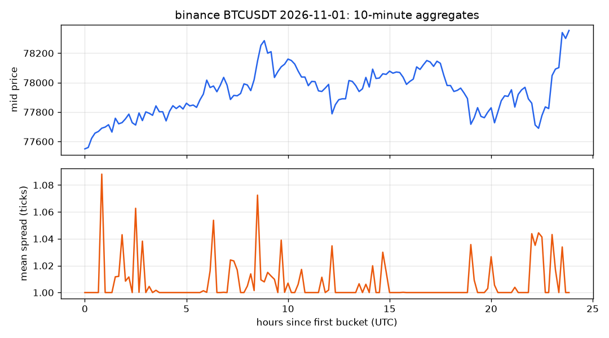

# M3 Real-Data Replay: Binance BTCUSDT, 2026-11-01

## Method

| | |
|---|---|
| Source | [Tardis.dev](https://tardis.dev) historical data. Day 1 of each month needs no API key. |
| Files | `incremental_book_L2` (59.9 MB gz), `trades` (8.6 MB gz), `book_snapshot_25` (17.2 MB gz) |
| Instrument | tick 0.01 USDT, lot 0.00001 BTC. Confirmed: every price and size in the day parsed exactly onto that grid. |
| Machine | Apple M3, macOS 26.5.1, Python 3.12.13, pure-Python replay into `LevelBook` |

To reproduce (about 3 minutes in total, mostly the download):

```bash
uv run python -m lobsim.marketdata download  --day 2026-11-01 --symbol BTCUSDT
uv run python -m lobsim.marketdata normalize --day 2026-11-01 --symbol BTCUSDT
uv run python -m lobsim.marketdata validate  --day 2026-11-01 --symbol BTCUSDT
uv run --group viz python -m lobsim.marketdata stats --day 2026-11-01 --symbol BTCUSDT --chart docs/benchmarks/m3-mid-spread.png
```

## Results

| | |
|---|---:|
| L2 rows | 10,171,484 |
| Book batches (exchange messages) | 859,250 |
| Trades | 1,147,208 |
| CSV.gz → Parquet normalize time | 27.7 s |
| **Snapshots checked against the rebuilt book** | **463,716** |
| **Snapshots matched exactly (top 25 levels, both sides)** | **463,716 (100%)** |
| Crossed books at snapshot times | 0 |
| Crossed books after any batch, all day | 0 |
| Full-day replay, Parquet → `LevelBook` | 13.2 s (768k L2 rows/s, 64.9k batches/s; an earlier run took 12.7 s, so expect ±5%) |
| Spread, time-weighted | p50 1 tick, p99 1 tick; 1 tick wide **99.99%** of the time |



## What this shows

- **The replay is right.** Every one of the 463,716 snapshots Tardis built from the same
  feed matches our rebuilt top 25 exactly. That covers each snapshot timestamp, every
  level, and both sides.
- **The "crossed book" handling was never exercised.** The book was never crossed on
  this day. The uncrossing rule in `validate.top_uncrossed` removes the best bid and best
  ask in pairs. That is our *approximation* of how the source cleans crossed levels, and
  it is covered by unit tests only, not by real data.
- **BTCUSDT on Binance is a one-tick market.** The spread is 0.01 USDT almost all day.
  So for M4, a passive order's fill depends almost entirely on its **queue position**
  at the best price, not on price improvement. That is why M4 models the queue.

## Data licence

Tardis's terms (§9) forbid redistributing raw data or derived *datasets*. Charts and
statistics are allowed. So:
- `data/` is git-ignored, and nothing from the downloaded files is committed.
- The test fixtures in `tests/data/` are hand-written synthetic rows.
- The chart shows 10-minute aggregates only.
