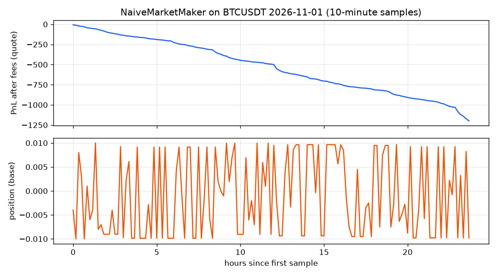

# M4 Backtest: Naive Market Maker on Binance BTCUSDT, 2026-11-01

## Method

| | |
|---|---|
| Data | The full M3 day: 2,006,458 market events (859,250 book batches + 1,147,208 trades) |
| Strategy | `NaiveMarketMaker`: one 0.001 BTC quote at the best bid and one at the best ask, re-quoting when a best price moves. Position limit ±0.01 BTC. |
| Fill model | Queue position for resting orders. Aggressive orders fill against visible depth only and are IOC. No market impact. See the README, "Fill model and known limits". |
| Default config | 1 ms order latency, 1 ms feed latency, maker and taker fees 10 bps each (Binance spot base tier) |
| Machine | Apple M3, Python 3.12.13. About 20 s per full-day run. |
| Reproducibility | The default run was executed twice. The JSON outputs are **byte-identical**. |

To reproduce:

```bash
uv run --group viz python -m lobsim.backtest --day 2026-11-01 --symbol BTCUSDT --json docs/benchmarks/m4-default.json --chart docs/benchmarks/m4-equity.png
uv run python -m lobsim.backtest --day 2026-11-01 --symbol BTCUSDT --maker-fee-bps 0 --taker-fee-bps 0
uv run python -m lobsim.backtest --day 2026-11-01 --symbol BTCUSDT --order-latency-us 0 --feed-latency-us 0
uv run python -m lobsim.backtest --day 2026-11-01 --symbol BTCUSDT --order-latency-us 10000 --feed-latency-us 10000
```

## Results

| Run | PnL after fees (USDT) | Gross PnL (USDT) | Fees (USDT) | Volume (BTC) maker / taker | Fills | Fill ratio | Gross per BTC traded |
|---|---:|---:|---:|---:|---:|---:|---:|
| Default (1 ms / 1 ms, 10 bps) | −1,210.83 | −162.85 | 1,047.98 | 13.277 / 0.168 | 27,287 | 61.3% | −12.11 USDT (−1.55 bps) |
| Zero fees | −162.85 | −162.85 | 0 | 13.277 / 0.168 | 27,287 | 61.3% | −12.11 USDT (−1.55 bps) |
| Zero latency | −1,903.35 | −254.32 | 1,649.03 | 21.155 / 0.000 | 27,111 | 71.4% | −12.02 USDT (−1.54 bps) |
| 10 ms / 10 ms | −984.07 | −118.42 | 865.65 | 9.937 / 1.169 | 25,037 | 56.7% | −10.66 USDT (−1.37 bps) |

JSON for each run: `m4-default.json`, `m4-zero-fees.json`, `m4-zero-latency.json`, `m4-10ms.json`.
Max |position| was 0.01 BTC (the limit) in every run.



## What this shows

1. **The strategy loses money even before fees, and that is the expected result for this
   strategy.** Quoting at the touch earns half a spread per fill. On this market that is
   0.005 USDT on 77,900 USDT, about **0.0006 bps**. Yet each BTC traded loses about
   **1.5 bps** gross.

   That gap is **adverse selection**. A passive quote mostly gets filled just as the price
   moves *through* it, so we buy right before the price drops and sell right before it
   rises. A naive market maker has no signal to avoid that.
2. **Fees are the next problem.** At 10 bps per side, fees (1,048 USDT) are about **6.4×**
   the gross loss. A real market maker on this pair needs fee tiers close to zero, or rebates.
3. **Lower latency did not help a naive strategy. It just traded more.** With zero latency
   the strategy filled 21.2 BTC instead of 13.4. Its gross loss *per BTC* stayed about the
   same, so the total loss grew. At 10 ms it filled less passive volume, but 1.17 BTC of
   its quotes were already crossing by the time they arrived, which made them taker fills.
   Speed amplifies whatever edge a strategy has, and this strategy has none.
4. **The system works.** A full day runs in about 20 s. Two runs give identical output.
   The accounting is exact, and the fills, fees and positions reconcile.

## Known limits of the fill model

These are restated in the README.
- **No market impact.** Our fills never remove liquidity from the replayed book, so
  aggressive orders are IOC.
- **Queue position is estimated, not known.** L2 data has no individual orders.
  - When a level shrinks, we assume the cancelled size was *ahead* of us. That is
    optimistic.
  - A trade that goes through our price, or a market that moves through it, fills our
    whole remainder. Without impact we can't tell how much of it would really have filled.
- Trades with an unknown taker side are ignored by the queue model.
- **Latency is a constant.** Real latency has jitter and tails.
- The equity curve marks to the exchange-side mid at 10-minute boundaries.
